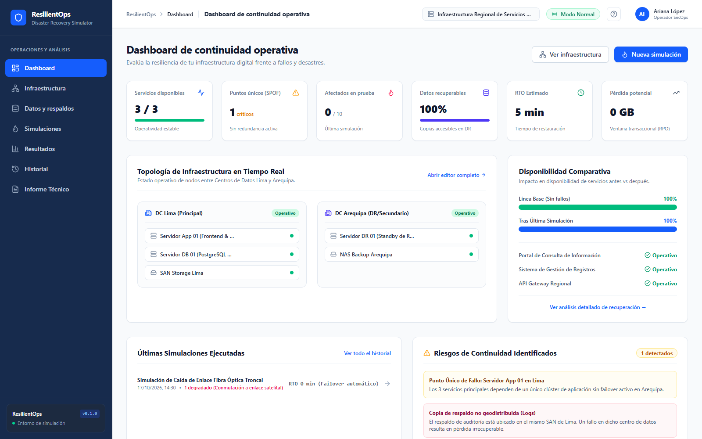

# ResilientOps

Simulador de continuidad operativa ante desastres.

ResilientOps permite modelar una infraestructura digital, simular fallos sobre ella y ver qué pasa con la disponibilidad de los servicios y con la recuperabilidad de los datos.

Proyecto del curso de Calidad de Software de la Universidad Nacional de Ingeniería (UNI).



## Funcionalidades

- **Dashboard de continuidad:** servicios disponibles, puntos únicos de fallo (SPOF), RTO, RPO y pérdida potencial de datos.
- **Modelado de infraestructura:** diagrama interactivo para agregar y editar centros de datos, servidores, almacenamiento y servicios.
- **Datos y respaldos:** registro de datasets críticos y de sus copias de respaldo.
- **Simulaciones:** asistente para elegir un escenario, configurar los fallos y ejecutarlo.
- **Resultados:** comparación antes/después, tabla de recuperación, hallazgos y SPOF detectados.
- **Historial:** registro de las simulaciones ejecutadas, que se pueden volver a abrir.
- **Informe técnico:** plan de recuperación ante desastres (DRP) listo para imprimir.

## Stack

| Tecnología | Versión | Uso |
|---|---|---|
| [Next.js](https://nextjs.org) | 16 | Framework (App Router) |
| [React](https://react.dev) | 19 | Interfaz |
| [Tailwind CSS](https://tailwindcss.com) | 4 | Estilos |
| [Lucide React](https://lucide.dev) | 1 | Íconos |
| TypeScript | 5 | Tipado estático |

No hay backend: toda la lógica corre en el navegador y los datos se guardan en `localStorage`.

## Correr en local

Requisitos:

- [Node.js](https://nodejs.org) 20.9 o superior.
- [pnpm](https://pnpm.io) 12.14.0, porque el proyecto usa `pnpm-lock.yaml`. Si no lo tienes, instálalo con `npm install -g pnpm@12.14.0` o antepón `npx pnpm@12.14.0` a cada comando.

```bash
git clone -b G2 https://github.com/ecuadros/2026-II-CS-UNI-SoftwareQuality-Code.git
cd 2026-II-CS-UNI-SoftwareQuality-Code
pnpm install --frozen-lockfile
pnpm dev
```

La aplicación queda en [http://localhost:3000](http://localhost:3000).

### Scripts

| Comando | Qué hace |
|---|---|
| `pnpm dev` | Servidor de desarrollo |
| `pnpm build` | Build de producción |
| `pnpm start` | Sirve el build de producción (antes hay que correr `pnpm build`) |

## Despliegue

Es una aplicación Next.js estándar sin variables de entorno, así que se despliega en [Vercel](https://vercel.com) importando el repositorio, sin configuración extra. En un servidor propio basta con `pnpm install --frozen-lockfile`, `pnpm build` y `pnpm start` (puerto 3000), detrás de un proxy inverso si hace falta.

## Estructura

```
src/
├── app/                 # layout, página principal y 404
├── components/
│   ├── dashboard/
│   ├── data/            # datasets y respaldos
│   ├── history/
│   ├── infrastructure/  # diagrama de topología
│   ├── layout/          # sidebar, header y modal de ayuda
│   ├── report/          # informe DRP
│   ├── results/
│   └── simulations/     # asistente de simulación
├── context/             # estado global
├── data/mockData.ts     # infraestructura inicial (Lima / Arequipa)
├── lib/                 # motor de simulación
└── types/resilient.ts
```

## Escenario de demostración

La aplicación arranca con la infraestructura de una entidad con dos centros de datos:

- **DC Lima (principal):** Servidor App 01, Servidor DB 01 (PostgreSQL) y SAN Storage Lima.
- **DC Arequipa (DR):** Servidor DR 01 en standby y NAS Backup Arequipa.

Están unidos por un enlace troncal de fibra óptica y uno satelital de respaldo. Sobre ellos corren tres servicios: el portal de consulta, el sistema de gestión de registros y el API Gateway regional.

Escenarios predefinidos:

1. Caída total del DC Lima (corte de energía e inundación).
2. Fallo de hardware del Servidor App 01.
3. Corte del enlace troncal de fibra Lima - Arequipa.
4. Fallo de la SAN de Lima.

## Autora

Ariana López (ariana.lopez.j@uni.pe)<br>
Facultad de Ingeniería Industrial y de Sistemas, UNI. Curso de Calidad de Software.

## Licencia

MIT

## Curso

- [Video de referencia](https://www.linkedin.com/posts/carlosfloreslopez_excelente-exposici%C3%B3n-que-todo-especialista-activity-7184935465374879744-MAFX?utm_source=share&utm_medium=member_android)
- [Material del curso](https://ecuadros.github.io/SoftwareQuality/)
